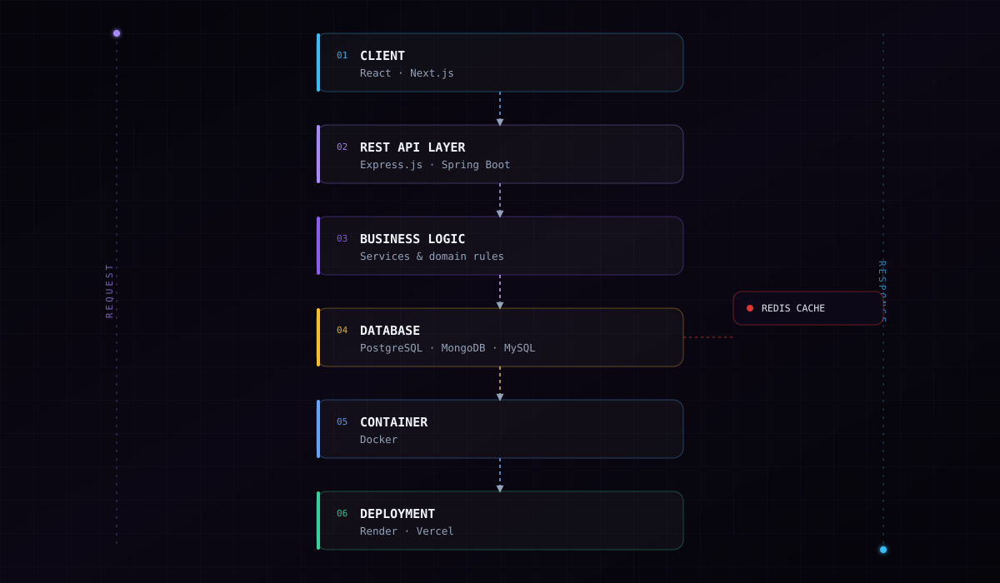

  

  

📍 Kanpur, Uttar Pradesh, India • 🎓 Final Year B.Tech Computer Science Engineering (2023–2027)

 

  

# 🖥️ System Identity

 

# 👨‍💻 About Me

<table>
<tr>

<td width="58%" valign="top">

Final-year **Computer Science Engineering** student passionate about building **scalable backend systems**, **modern full-stack web applications**, and **AI-powered products**.

My primary stack includes **Java**, **Spring Boot**, **React**, **Next.js**, **PostgreSQL**, and **Docker**. I enjoy designing clean architectures, writing maintainable code, and continuously improving my engineering skills through real-world projects.

Currently focused on strengthening backend engineering fundamentals while learning **System Design**, **Cloud Technologies**, and **production-ready software development**.

 

| | |
|---|---|
| 🚀 **Building** | CareerOS AI — AI-powered Career Platform |
| 🌱 **Learning** | System Design, Docker, Kubernetes |
| 💡 **Interests** | Backend Engineering, Cloud, AI |
| 💬 **Ask Me About** | Java, Spring Boot, REST APIs, React |
| 📫 **Email** | abhaykushwaha06@gmail.com |
| 🎓 **Graduation** | B.Tech CSE • 2027 |

</td>

<td width="42%" valign="top">

</td>

</tr>
</table>

 

# 🏗️ Infrastructure Overview

Typical architecture used across my projects—modern frontend, REST APIs, relational databases, and containerized deployments with Docker.

 

 

## 🛠️ Technology Stack

 

<table align="center">
<tr>

<td width="25%" valign="top">

### 💻 Languages

Java • JavaScript • TypeScript • Python • C++ • SQL

</td>

<td width="25%" valign="top">

### 🎨 Frontend

React • Next.js • Tailwind CSS • Bootstrap

</td>

<td width="25%" valign="top">

### ⚙️ Backend

Spring Boot • Node.js • Express.js • REST APIs

</td>

<td width="25%" valign="top">

### ☁️ Data & DevOps

PostgreSQL • MongoDB • MySQL • Firebase • Redis • Docker

</td>

</tr>
</table>

 

### 🧰 Development Toolkit

 

Git • GitHub • GitHub Actions • VS Code • IntelliJ IDEA • Postman • Docker • Linux • Vercel

---

## 🚀 Featured Projects

<table>
<tr>
<td width="100%" valign="top">

### 🚗 Smart Parking System &nbsp;&nbsp;

An ANPR-based smart parking solution engineered to automate vehicle entry, track real-time parking sessions, calculate billing, and verify secure payments prior to exit.

#### 🛠️ Technology Stack
`React` • `TypeScript` • `Java 21` • `Spring Boot 3` • `Spring Security` • `Spring Data JPA` • `PostgreSQL` • `Flyway` • `Maven`

#### 💡 Key Highlights
- 🚘 **ANPR Integration:** Automated number plate recognition for seamless vehicle entry workflows.
- 🅿️ **Session Management:** Real-time tracking of parking duration and live occupancy.
- 💳 **Secure Billing & Exit:** Automated fee computation coupled with pre-exit payment verification.
- 🗄️ **Robust Persistence:** Clean database architecture backed by automated Flyway schema migrations.

🔗 **Repository:** [Smart Parking Repository](https://github.com/Abhay924/Smart_Parking-)

</td>
</tr>
</table>

 

<table>
<tr>
<td width="100%" valign="top">

### 🛍️ Full-Stack E-Commerce Platform &nbsp;&nbsp;

A high-performance full-stack e-commerce ecosystem featuring secure user authentication, an interactive product catalog, complete cart workflows, and modern cloud deployment.

#### 🛠️ Technology Stack
`React` • `Vite` • `Tailwind CSS` • `Firebase Auth` • `Java` • `Spring Boot` • `MySQL` • `Vercel` • `Railway`

#### 💡 Key Highlights
- 🛒 **End-to-End Commerce:** Seamless product browsing, dynamic filtering, and cart management workflows.
- 🔐 **Secure Authentication:** Robust user verification and session handling powered by Firebase.
- 🗄️ **Relational Persistence:** Scalable MySQL database modeling robust product and user data.
- 🚀 **Production Architecture:** High-availability deployment architecture hosted live on Vercel and Railway.

🔗 **Repository:** [E-Commerce Repository](https://github.com/Abhay924/Full-Stack-E-commarce-) &nbsp;|&nbsp; 🌐 **Live App:** [View Application](https://ecommerce-frontend-lime-five.vercel.app)

</td>
</tr>
</table>

 

<table>
<tr>
<td width="100%" valign="top">

### ⭐ CareerOS AI &nbsp;&nbsp;

An intelligent, AI-powered career enhancement platform designed to assist software engineering aspirants with automated resume optimization, deep company research, and structured interview prep.

#### 🛠️ Technology Stack
`Next.js` • `React` • `TypeScript` • `NestJS` • `PostgreSQL` • `Prisma` • `Turborepo` • `pnpm`

#### 💡 Key Highlights
- 🤖 **AI-Driven Coaching:** Intelligent career guidance and personalized learning paths.
- 📄 **ATS Optimization:** Advanced resume analysis mapping skill gaps against target roles.
- 🎯 **Interview Workflows:** Curated interview preparation modules and company research tools.
- 🔐 **Modular Architecture:** Secure backend APIs built with NestJS and Prisma ORM.

🔗 **Repository:** [CareerOS AI Repository](https://github.com/Abhay924/CAREEROS-AI)

</td>
</tr>
</table>

 

<table>
<tr>
<td width="50%" valign="top">

### 🌱 Green Habit Tracker &nbsp;&nbsp;

A sustainability-focused web application crafted to help users cultivate eco-friendly routines and track daily green habit streaks.

#### 🛠️ Stack
`HTML5` • `CSS3` • `JavaScript`

#### 💡 Highlights
- 🌿 Daily eco-friendly habit tracking
- 🔥 Streak analytics for consistency
- 🌍 Actionable insights for sustainable living

🔗 **[GitHub Repo](https://github.com/Abhay924/Green-Habit-)**

</td>
<td width="50%" valign="top">

### 📊 E-Commerce Business Analytics &nbsp;&nbsp;

An advanced SQL analytics project querying commercial datasets to extract actionable customer behavior insights and business intelligence metrics.

#### 🛠️ Stack
`SQL` • `Relational DBs` • `Window Functions`

#### 💡 Highlights
- 💰 Revenue & sales trend breakdowns
- 🎯 RFM customer segmentation models
- 📈 Cohort and retention analytics

🔗 **[GitHub Repo](https://github.com/Abhay924/ecommerce-business-analytics)**

</td>
</tr>

<tr>
<td width="50%" valign="top">

### 🏢 Nexyra Systems &nbsp;&nbsp;

The official digital footprint and client portal for Nexyra Systems, delivering specialized IT software solutions, web applications, and AI integrations.

#### 🛠️ Stack
`Next.js` • `Tailwind CSS` • `Node.js` • `MongoDB`

#### 💡 Highlights
- 🌐 Professional corporate web identity
- 📩 Integrated client inquiry funnels
- 💻 Scalable digital service showcases

🌐 **[Visit Website](https://nexyrasystems.com)**

</td>
<td width="50%" valign="top">

### 💻 LeetCode Solutions &nbsp;&nbsp;

A curated public repository tracking continuous algorithmic problem-solving mastery in data structures and core computer science concepts.

#### 🛠️ Stack
`Java` • `Data Structures` • `Algorithms`

#### 💡 Highlights
- 🧮 Arrays, Strings, and Hashing
- 🌳 Trees, Graphs & Dynamic Programming
- 🧠 Optimized time/space complexity solutions

🔗 **[GitHub Repo](https://github.com/Abhay924/leetcode-solutions)**

</td>
</tr>
</table>

### 🎯 Engineering Focus

My focus is on solving real-world problems, writing maintainable code, understanding architectural trade-offs, and continuously improving my software engineering skills.

#### Core Interests

- 🎨 Frontend and responsive UI development
- ⚙️ Backend engineering and API development
- 🗄️ Database design and optimization
- 🏗️ Scalable application architecture
- 🧠 Data structures and algorithms

</td>
<td width="50%" valign="top">

</td>
</tr>
</table>

 

> 💡 **Building practical applications with clean interfaces, reliable backends, and maintainable architecture.**

 

*"Building software that is reliable, scalable, and designed to solve real-world problems."*

  

##  Architecture References

<table align="center">
<tr>
<td align="center" width="25%">📐 <b><a href="./.github/diagrams/system-design.md">System Design</a></b></td>
<td align="center" width="25%">⚙️ <b><a href="./.github/diagrams/backend-architecture.md">Backend Architecture</a></b></td>
<td align="center" width="25%">🚀 <b><a href="./.github/diagrams/deployment-flow.md">Deployment Flow</a></b></td>
<td align="center" width="25%">🌐 <b><a href="./.github/diagrams/network-topology.md">Network Topology</a></b></td>
</tr>
</table>

 

##  Engineering Analytics

<!-- ========================= Engineering Analytics ========================= -->

  

### 📈 Contribution Activity

<!-- Activity Graph -->

  

### 🚀 Profile Highlights

  <i>✨ Every commit represents a step toward building impactful software.</i>

## 🚀 Engineering Timeline

| Year | Milestone |
|------|-----------|
| **2023** | Started B.Tech in Computer Science & Engineering. Learned C, C++, HTML, CSS, JavaScript, Git/GitHub, and programming fundamentals. |
| **2024** | Built frontend applications with React.js and backend APIs using Node.js & Express.js. Strengthened problem-solving skills through DSA while improving DBMS, OOPs, and SQL concepts. |
| **2025** | Developed full-stack MERN applications using MongoDB and Firebase. Built projects including Green Habit Tracker and gained experience with REST APIs, authentication, and cloud deployment. |
| **2026** | Building scalable applications such as CareerOS AI, Smart Dairy Store, and Nexyra Systems while preparing for Software Engineer roles by strengthening DSA, backend development, and system design. |
 

##  Learning Roadmap

- [x] Java fundamentals and object-oriented design
- [x] Full-stack development with React and Node.js
- [x] Spring Boot — building learning-scale microservices
- [ ] System Design — scalable architecture patterns
- [ ] Cloud & CI/CD — AWS, Kubernetes fundamentals
- [ ] Contributing to open-source Java / Spring projects

 

## 🏅 Certifications

| | Certification | Issuer / Platform | Focus |
|:---:|---|---|---|
| ☁️ | **IBM AI Fundamentals** | IBM | Artificial Intelligence |
| 🗄️ | **SQL (Intermediate)** | HackerRank | SQL & Databases |
| 🐍 | **Python (Basic)** | HackerRank | Python Programming |
| ☕ | **Java Programming** | Oracle | Java Development |
| 🤖 | **AI Foundation** | IBM | AI Fundamentals |
| 🧩 | **Full Stack Development** | FreeCodeCamp | Web Development |
| 🌐 | **Networking Basics** | Cisco Networking Academy | Computer Networks |

 

`Artificial Intelligence` • `Java` • `Python` • `SQL` • `Full Stack` • `Networking`

💡 Continuously strengthening my software engineering fundamentals through industry-recognized learning and hands-on development.

 

##  Contact

 

